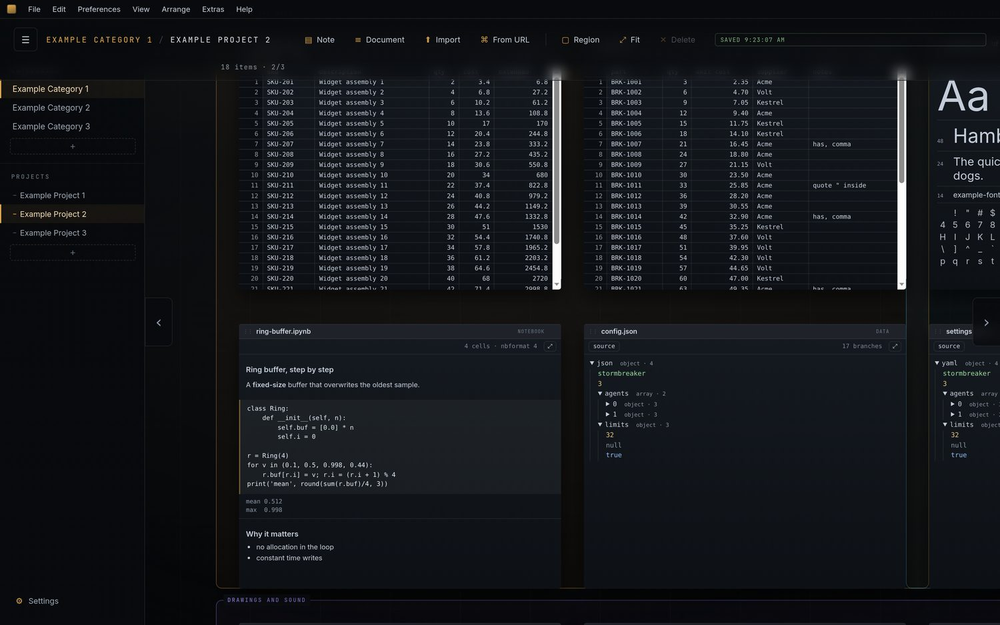
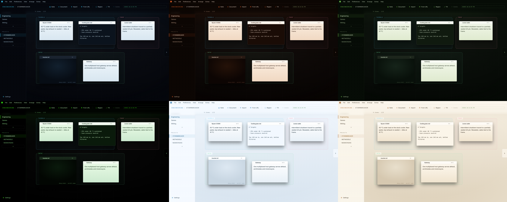
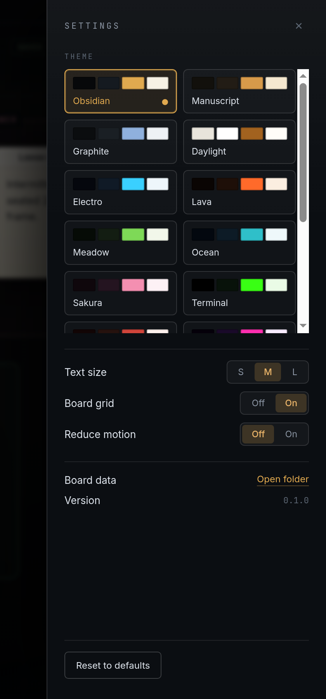

# Nookstacks

Your noggin, your nook. Organization your way. 

Categories stack into projects, projects open onto an infinite board, and the board
holds whatever you want! Notes, documents, drawings, PDFs, 3D models,
audio, links, and many more!

## Try it first

**[nookstacks.io](https://nookstacks.io)** — the whole app in a browser tab, no install.
A new board starts empty. If you want something to look at, *File → Add a template* drops
in one of three ready-made boards — a guided tour, one card of every kind of file, or a
media set — beside your own cards or as a new project. Whatever you do is kept in your
own browser, never uploaded.


## What's in it

- **Cards for anything** — notes, markdown, images, PDFs, audio, video, 3D models and plain files, each with the viewer it deserves.
- **Regions** — coloured frames that group part of a board. They sit *behind* their contents, so you work inside one as if it weren't there; drag the tab and the region moves.
- **Select in bulk** — click, `Ctrl`-click, `Shift`-click, or drag a box over the board. Whatever is selected moves together, cards and regions alike.
- **Menus built per thing** — a note edits and copies its text, a model frames and wireframes, media plays and loops, a region recolours, a category or a project renames and recolours, the empty board makes new things.
- **Colour where you are** — give a category or a project one of eight hues and its row wears a faint wash of it, so a rail of twelve boards stays readable.
- **A file, not a service** — one folder of JSON and blobs, autosaved, 40 rolling backups, 80 steps of undo. No account, no sync, no network.
- **Boards travel** — *File → Export* writes a `.nks` bundle: the board, its regions and every file on it, in one zip. *Open board* reads it back. The desktop app asks where to save; the browser downloads it.
- **Fits the screen you have** — a collapsible rail on desktop and tablet (`Ctrl+B`, or the thin bar it leaves behind), and on a phone the rail becomes a drawer, one finger pans, two pinch, and a long press opens the menu.

## Updating

The desktop app updates itself. **Preferences → Check for updates…** asks the newest
release what it has, downloads the installer for this platform, checks it against the
sha256 published with that release, runs it and reopens Nookstacks on the new version.

- **Windows** — the per-user NSIS setup, silently. No admin prompt, no uninstall first.
- **Linux** — an AppImage replaces itself in place. A `.deb`/`.rpm` install cannot, and
  the panel says so instead of failing.
- **Web** — nothing to do. A reload is the update.

`nookstacks --update-now` does the same without opening a window and writes each step to
`updater.log` beside the vault, which is how the release check verifies the path.

## Starting empty, with templates

Nothing is created for you. The first board is blank, with one empty project and a card
that offers the two things you actually want: a template, or your own files.

Three templates ship with the app, and they only ever *add* — your cards stay where they are:

- **Start here** — six notes: dragging, regions, shortcuts, where files live.
- **Everything it opens** — one card of every file type the app can read (18 cards).
- **Media and models** — a picture, a clip, a sound, a PDF and a model you can orbit.

## What it opens

A card is not a file icon. It is the file, read in place:

- **Sheets** — xlsx, xls, ods, csv and tsv as a grid, with sheet tabs and a row gutter.
- **Documents** — PDF, markdown and text edited where they sit; notebooks (`ipynb`) with their outputs; `epub` and `fb2` as chapters.
- **Data** — json, yaml, toml and xml as a collapsible tree, with the source one click away and editable.
- **Drawings** — DXF as vector geometry; 3MF, GLB, GLTF, OBJ, STL, PLY, FBX and Blender files as models you can orbit; mermaid diagrams rendered from source.
- **Sound and film** — mp3, wav, ogg, m4a, flac, mp4, webm, mov, mkv; MIDI as a piano roll that plays.
- **Lists and containers** — zip and tar as a browsable listing you can pull files out of; subtitles as cues; `ics` calendars and `vcf` contacts; geojson, gpx and kml on a canvas.
- **Fonts** — ttf, otf, woff and woff2 as a live specimen.

Anything else keeps the plain tile and a download link. Parsers are fetched the first
time a card needs one, so opening a board of notes costs nothing.



## Regions

A region is a coloured frame that groups part of a board — thermals, power, infra.
It never takes a click, so everything inside stays usable, and its tab is the
handle: drag it and the region (with anything else selected) moves. Eight colours,
right-click to pick one.


## Themes

Sixteen palettes — Obsidian, Manuscript, Graphite, Daylight, **Electro**, **Lava**,
**Meadow**, **Ocean**, **Sakura**, **Terminal**, **Ember**, **Neon**, **Iris**,
**Mono**, **Frost**, **Sand** — plus a **Custom** theme you build from five colours.





## Keys

| | |
|---|---|
| `↑ ↓` / `← →` | change category / project |
| `N` / `T` | new note / new document |
| `G` | draw a region |
| `F` | fit the board · `Ctrl` `+` `−` `0` zoom |
| `Ctrl+Z` / `Ctrl+Shift+Z` | undo / redo |
| `Ctrl+C` `X` `V` `D` | copy, cut, paste, duplicate |
| `Ctrl+A` / `Del` | select all / delete |
| right-drag | pan the board |
| `S` | settings |

## Install

**Windows** — [download `Nookstacks_0.1.0_x64-setup.exe`](../../releases/latest); it installs per-user, no admin rights needed.

**Linux** — take the `.deb` or `.AppImage` from the same [release](../../releases/latest); the `.deb` pulls in `libwebkit2gtk-4.1`.

**Browser** — nothing to install: **[nookstacks.io](https://nookstacks.io)**.
The board is kept in that browser's own storage. No account, no server.

To run it locally against a vault folder instead:

```bash
python3 dev/server.py 8787        # http://localhost:8787
```

## Build your own installers

Rust 1.77+ and the [Tauri CLI](https://tauri.app), plus `libwebkit2gtk-4.1-dev`,
`libgtk-3-dev`, `librsvg2-dev` and `patchelf` on Linux.

```bash
cargo tauri build --bundles nsis   # Windows
cargo tauri build --bundles deb    # Linux
```

Output lands in `src-tauri/target/release/bundle/`.

## Your data

```
state.json     every category, project, region and card
history/       the last 40 saves
blobs/         imported files, one per import
```

Windows: `%APPDATA%\Nookstacks\vault` · Linux: `~/.local/share/Nookstacks/vault`.
Set `NOOKSTACKS_VAULT` to keep it somewhere else, like a synced folder.

## License

GNU General Public License v3.0 or later. The full text is in [LICENSE](LICENSE);
the SPDX identifier is `GPL-3.0-or-later`.

In plain terms: you can run it, study it, change it and share it. If you
distribute a changed version — as an app, an installer or a hosted service —
you have to publish the source of your version under the same licence. Selling
it is allowed; closing it is not.

Releases published before this change (0.2.3 and earlier) went out under MIT and
stay under MIT; their archived installers are unaffected. Everything in this
repository from now on is GPLv3.

An installer is a binary, and the GPL wants the matching source beside it. For
any release, that is the repository at the tag it was built from
(`git checkout v0.4.0`), including the vendored libraries under `web/vendor/`,
which keep their own permissive licences (MIT) and are compatible with this one.
