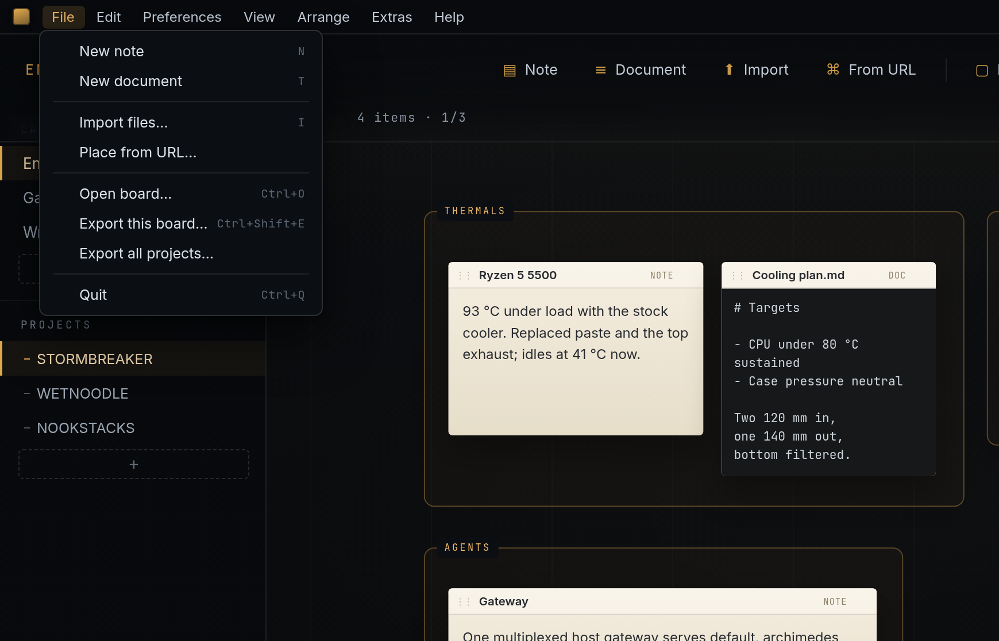
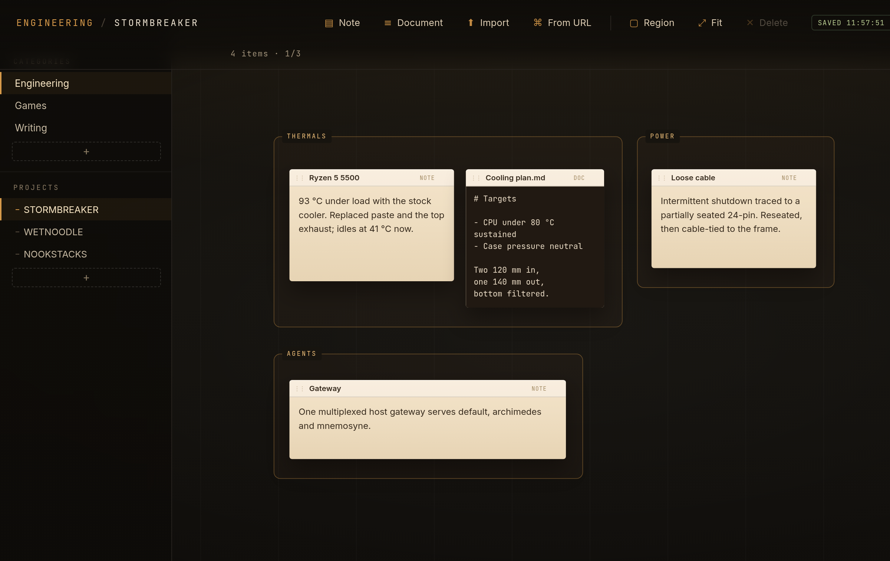
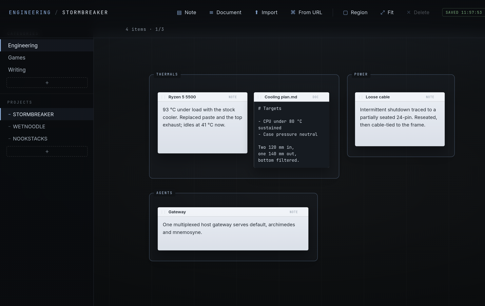
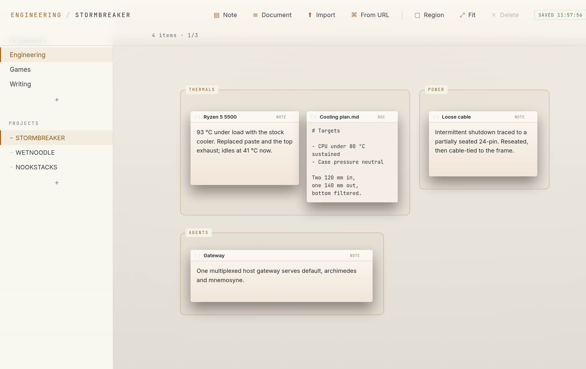

# Nookstacks


A tower of project bookshelves. Each category is a level, each level holds projects, each project is an infinite board where you place documents — notes, code, PDFs, images, video, 3D models — anywhere, at any size, and edit the text ones in place.

Local only. No account, no sync service, no telemetry. Your board is a directory on your disk that you can back up, copy between machines, or open with a text editor.

Windows and Linux.

## Install

Grab the installer for your system from [Releases](../../releases).

**Windows** — run `Nookstacks_*_x64-setup.exe`. It installs per-user, so no administrator rights are needed. The `.msi` is there if you prefer MSI deployment.

**Linux** — take the `.AppImage`, make it executable, run it:

```bash
chmod +x Nookstacks_*.AppImage
./Nookstacks_*.AppImage
```

Or use the `.deb` / `.rpm` for your distribution's package manager. Both pull in `libwebkit2gtk-4.1`, which the app renders with.

## Where your data lives

| OS | Path |
|---|---|
| Windows | `%APPDATA%\Nookstacks\vault` |
| Linux | `~/.local/share/Nookstacks/vault` |

Inside is the whole board:

```
state.json          every level, project, region and document
state.json.bak      the previous save
history/            rolling snapshots, the last 40 saves
blobs/              imported files, one file per import
```

Saves are atomic — written to a temp file, fsynced, then renamed — so an interrupted write can't corrupt `state.json`. Set `NOOKSTACKS_VAULT=/some/path` to keep the vault somewhere else, such as a synced folder.

## Using it

| | |
|---|---|
| `↑` `↓` | change level |
| `←` `→` | change project |
| `N` | new note where the cursor is |
| `G` | draw a region around things |
| double-click a category or project name | rename it in place — `Enter` keeps, `Esc` cancels |
| `S` | open settings |
| `Ctrl+Z` / `Ctrl+Shift+Z` | undo / redo (80 steps) |
| `Ctrl+C` / `Ctrl+X` / `Ctrl+V` | copy, cut, paste the selected card |
| `Esc` | close the settings panel, cancel a region, deselect |
| double-click a note | edit it, click away to save |
| right-drag | pan the board |
| wheel | zoom; over a scrollable document or a model, it scrolls or zooms that instead |
| double-click a model | nothing — drag to orbit, wheel to zoom |

Regions get moved by their label, resized by their corner handles, renamed by double-clicking the label, and deleted with the ✕ inside it.

## The menu bar

File, Edit, Preferences, View, Arrange, Extras and Help, along the top of the window — `Alt` + the first letter opens one, arrows walk it, `Enter` runs it.

- **File** — new note or document, import files, place from a URL, open a `.nks` board, export this board or the whole tower, quit
- **Edit** — duplicate, delete, rename the project or the category
- **Preferences** — preferences panel, theme, text size, export/import settings
- **View** — fit, zoom in/out/actual size, board grid, reduce motion, show sidebar
- **Arrange** — bring to front, send to back, tidy the board, centre the selection
- **Extras** — open or copy the vault path, board info
- **Help** — keyboard shortcuts, README, about



## Boards as files: `.nks`

A `.nks` file is one board, or the whole tower, in a single file you can email, back up or carry between machines.

**File → Export this board…** (`Ctrl+Shift+E`) writes a bundle of the project you're on: its regions, its documents, and every file attached to them. **File → Export all projects…** does the same for everything.

**File → Open board…** (`Ctrl+O`) reads one back. A single board arrives as a new project beside the one you're on; a whole-tower bundle asks first, then replaces what's open (your previous state stays in `vault/history`).

Under the hood it's a zip:

```
nookstacks.json     format id, version, scope, name, which blobs are inside
state.json          the board itself
blobs/<hash>        every attached file, addressed by content hash
```

Blobs are keyed by hash and nothing in the state is an absolute path, so a board exported on Windows opens on Linux with nothing to relink. Importing twice does not duplicate the attached files, and a bundle from a newer Nookstacks is refused rather than half-read.

**Preferences → Export settings… / Import settings…** does the same for just your preferences, as a small JSON file.

## Settings and themes

Click **⚙ Settings** at the bottom of the sidebar, or press `S`.

**Themes** — the whole interface is drawn from one set of colour tokens, so a theme is a palette swap and every surface follows it:

- **Obsidian** — near-black, amber accent, cream paper. The default.
- **Manuscript** — warm browns and parchment, for long evenings.
- **Graphite** — cool neutral with a steel-blue accent.
- **Daylight** — light chrome and warm paper, for a bright room or a projector.


**Text size** — S / M / L, scaling card titles, note text and code.

**Board grid** — turn the dotted grid off for a cleaner canvas.

**Reduce motion** — disables board travel animation and zooming transitions. The app also honours your system's reduced-motion preference when this is left at Off.

**Fit** frames every card and region on the shelf, however far it sits from the centre — park something 5000 px away and Fit zooms out until it is on screen too.

**Tidy board** packs the shelf into balanced columns using each card's real width and height, and treats a region as one unit: its cards stack inside it and the region is measured to wrap them, so tidying cannot leave a card half in and half out. Shortest column wins, and the order the cards already read in is kept.

**Undo** keeps the last 80 states of the board, so a tidy, a drag or a deletion is one `Ctrl+Z` away; typing in a note is coalesced into a single step. Copy and paste work on cards, and a pasted card shares the underlying file rather than duplicating it.

**Board data → Open folder** — opens the vault directory in your file manager, so backups are one click away.

Your choices are stored in `state.json` alongside the board, under `settings`, so they travel with the vault and survive reinstalls. **Reset to defaults** puts everything back to Obsidian, M, grid on, motion on.

<p align="center">
  
  
  
</p>

## Build from source

You need Rust 1.77 or newer. Then:

```bash
cd src-tauri
cargo build --release
```

On Linux you also need the WebKit headers:

```bash
sudo apt install libwebkit2gtk-4.1-dev libgtk-3-dev librsvg2-dev patchelf
```

Installers:

```bash
cargo install tauri-cli --version "^2"
cd src-tauri && cargo tauri build
```

Output lands in `src-tauri/target/release/bundle/`. On Linux that's `deb/`, `rpm/` and `appimage/`; on Windows, `nsis/` and `msi/`. Each OS builds its own installers — CI does both in `.github/workflows/build.yml`, and pushing a `v*` tag publishes them to a draft release.

## How it's put together

The same web bundle runs in two shells:

```
web/                 the entire interface, plain ES modules, no build step
web/style.css        layout, driven entirely by colour tokens
web/themes.css       the palettes: one block of variables per theme
src-tauri/           the desktop shell: Rust, file system, installers
dev/server.py        a small HTTP server with the same API, for browser dev
```

`web/app.js` has one storage interface (`vault`) with two implementations. Inside the Tauri window it calls Rust over IPC; in a browser it calls `/api/*` on the dev server. Both write the identical on-disk format, so a vault is portable between the app and the dev server.

Three.js, the `.blend` parser and the Zstandard decoder are vendored under `web/vendor/`, so there is no `npm install` and no bundler anywhere in the build.

Working on the interface without rebuilding Rust:

```bash
python3 dev/server.py 8787   # then open http://localhost:8787
```

## License

MIT. See [LICENSE](LICENSE).
