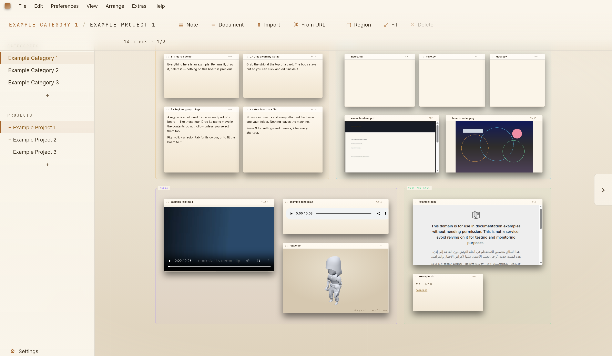
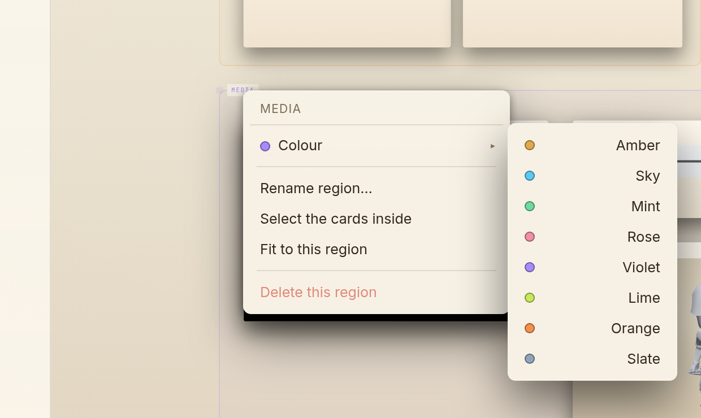

# Nookstacks

A quiet place to put everything you're building.

Categories stack into projects, projects open onto an infinite board, and the board
holds whatever the work actually is — notes, documents, drawings, PDFs, 3D models,
audio, links, and the coloured regions that group them.

## Try it first

**[nookstacks.io](https://nookstacks.io)** — the whole app in a browser tab, no install.
It opens on a demo board (Example Category 1 → Example Project 1) with one of every
kind of card, and whatever you do there is kept in your own browser, never uploaded.



## What's in it

- **Cards for anything** — notes, markdown documents, images, PDFs, audio, video, 3D models (STL/OBJ) and plain files, each with the viewer it deserves.
- **Regions** — coloured frames that group part of a board. They sit *behind* their contents, so you work inside one as if it weren't there; drag the tab and the region moves.
- **Select in bulk** — click, `Ctrl`-click, `Shift`-click, or drag a box over the board. Whatever is selected moves together, cards and regions alike.
- **Menus built per thing** — a note edits and copies its text, a model frames and wireframes, media plays and loops, a region recolours, the empty board makes new things.
- **A file, not a service** — one folder of JSON and blobs, autosaved, 40 rolling backups, 80 steps of undo. No account, no sync, no network.

## Regions

A region is a coloured frame that groups part of a board — thermals, power, infra.
It never takes a click, so everything inside stays usable, and its tab is the
handle: drag it and the region (with anything else selected) moves. Eight colours,
right-click to pick one.



## Themes

Sixteen palettes — Obsidian, Manuscript, Graphite, Daylight, **Electro**, **Lava**,
**Meadow**, **Ocean**, **Sakura**, **Terminal**, **Ember**, **Neon**, **Iris**,
**Mono**, **Frost**, **Sand** — plus a **Custom** theme you build from five colours.


## Keys

| | |
|---|---|
| `↑ ↓` / `← →` | change category / project |
| `N` / `T` | new note / new document |
| `G` | draw a region |
| `F` | fit the board · `Ctrl` `+` `−` `0` zoom |
| `Ctrl+Z` / `Ctrl+Shift+Z` | undo / redo |
| `Ctrl+C` `X` `V` `D` | copy, cut, paste, duplicate |
| `Ctrl+A` / `Del` | select all / delete |
| right-drag | pan the board |
| `S` | settings |

## Install

**Windows** — [download `Nookstacks_0.1.0_x64-setup.exe`](../../releases/latest); it installs per-user, no admin rights needed.

**Linux** — take the `.deb` or `.AppImage` from the same [release](../../releases/latest); the `.deb` pulls in `libwebkit2gtk-4.1`.

**Browser** — nothing to install: **[nookstacks.io](https://nookstacks.io)**.
The board is kept in that browser's own storage. No account, no server.

To run it locally against a vault folder instead:

```bash
python3 dev/server.py 8787        # http://localhost:8787
```

## Build your own installers

Rust 1.77+ and the [Tauri CLI](https://tauri.app), plus `libwebkit2gtk-4.1-dev`,
`libgtk-3-dev`, `librsvg2-dev` and `patchelf` on Linux.

```bash
cargo tauri build --bundles nsis   # Windows
cargo tauri build --bundles deb    # Linux
```

Output lands in `src-tauri/target/release/bundle/`.

## Your data

```
state.json     every category, project, region and card
history/       the last 40 saves
blobs/         imported files, one per import
```

Windows: `%APPDATA%\Nookstacks\vault` · Linux: `~/.local/share/Nookstacks/vault`.
Set `NOOKSTACKS_VAULT` to keep it somewhere else, like a synced folder.

## License

MIT. See [LICENSE](LICENSE).
